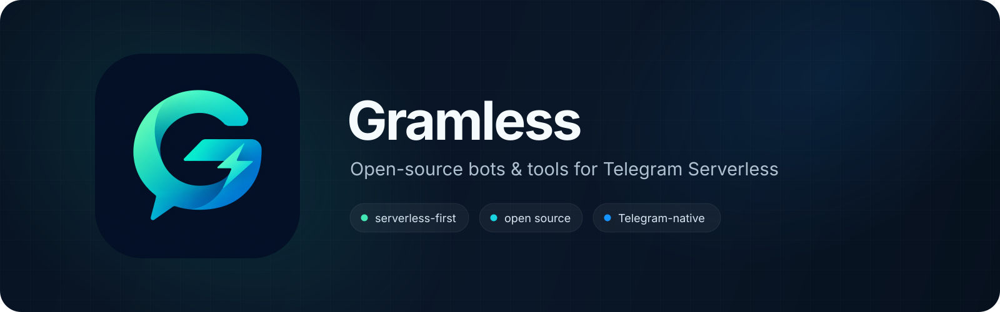

<div align="center">



<br />

**Build useful Telegram bots without managing servers.**

Open-source bots, templates, and developer tools designed specifically for  
**Telegram Serverless**.

<br />

[](https://core.telegram.org/bots/serverless)
[](#)
[](#)

</div>

---

## What is Gramless?

**Gramless** is an independent open-source organization focused on building polished, practical software for Telegram's Serverless platform.

The goal is simple: create bots that are genuinely useful, easy to deploy, and do not require users to maintain a VPS, reverse proxy, external database, or a pile of infrastructure just to keep a Telegram bot online.

We build around the platform instead of treating Serverless as an afterthought.

## Principles

- **Serverless-first** — projects should run primarily on Telegram Serverless.
- **Useful by default** — real tools, not demo bots.
- **Easy to deploy** — minimal setup and sane defaults.
- **Clean UX** — Telegram-native interactions with polished user experience.
- **Open source** — readable code, clear documentation, and reusable building blocks.
- **Minimal infrastructure** — external services are used only when the product actually needs them.

## Projects

### Gramless Support

> A Telegram-native helpdesk built around private messages and forum topics.

Users message the bot normally. Each conversation becomes a structured support ticket for your team, with replies relayed back to the user.

**Status:** coming soon.

Planned features include ticket topics, assignments, departments, tags, internal notes, attachments, close/reopen flows, transcripts, ratings, and an optional admin Mini App.

---

## What belongs here?

Gramless projects should make sense specifically because Telegram Serverless exists.

Good fits include:

`support bots` · `feedback tools` · `forms` · `moderation` · `waitlists` · `utilities` · `Mini Apps` · `developer templates`

If a project requires a traditional backend for everything, it probably belongs somewhere else.

## Repository conventions

We aim to keep repositories predictable:

```text
project/
├── README.md
├── LICENSE
├── handlers/
├── lib/
├── migrations/
└── ...
```

Each project should include:

- a clear setup guide;
- deployment instructions;
- required bot permissions;
- environment/configuration documentation;
- screenshots or a short demo where useful;
- an explicit list of external dependencies, if any.

## Contributing

Contributions are welcome.

For project-specific bugs and features, open an issue in the relevant repository. For larger changes, start with an issue or discussion before investing heavily in an implementation.

We value small, focused pull requests and code that stays understandable without unnecessary abstraction.

## About Telegram Serverless

Telegram Serverless allows bot code, persistent data, Mini App frontends, and backend logic to run on Telegram's infrastructure.

Official documentation:

**https://core.telegram.org/bots/serverless**

---

<div align="center">

**No VPS. Less infrastructure. More Telegram.**

<sub>Gramless is an independent open-source project and is not affiliated with or endorsed by Telegram.</sub>

</div>
